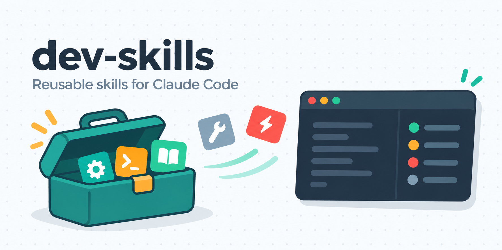
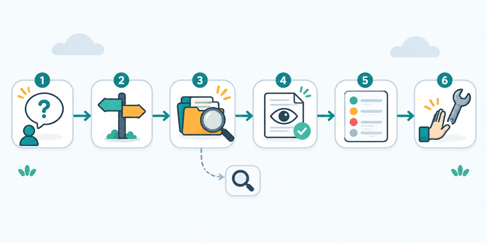
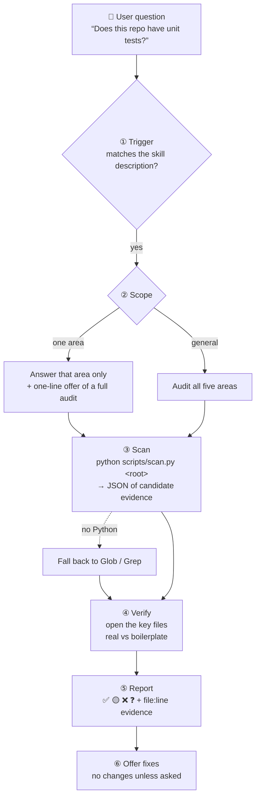

<div align="center">



**A Claude Code plugin marketplace of reusable engineering skills.**


</div>

---

## Contents

- [What's inside](#-whats-inside)
- [Install](#-install)
- [project-health-audit](#-project-health-audit)
  - [Workflow](#workflow)
  - [Inputs](#inputs)
  - [Outputs](#outputs)
  - [With the skill vs without](#with-the-skill-vs-without)
- [Repository layout](#-repository-layout)
- [Adding and testing a skill](#-adding-and-testing-a-skill)
- [Contribution rules](#-contribution-rules)

---

## 📦 What's inside

| Plugin | Skill | What it does | Triggers on questions like |
|---|---|---|---|
| `dev-workflow` | [`project-health-audit`](#-project-health-audit) | Checks whether a project really has tests, a health check, linting, CI and git hooks, with file-level evidence | "Does this repo have unit tests?", "Do we have a health check?", "Is this ready for production?" |

<!-- Optional: docs/images/architecture.png (prompt in docs/image-prompts.md). -->

A **marketplace** lists plugins. A **plugin** is the unit you install and version. A **skill** is one capability inside a plugin, invoked as `plugin:skill`.

```text
marketplace  dev-skills
└── plugin   dev-workflow            (v0.1.0)
    └── skill  project-health-audit  → /dev-workflow:project-health-audit
```

---

## 🚀 Install

In Claude Code:

```text
/plugin marketplace add pipatpong1412/dev-skills
/plugin install dev-workflow@dev-skills
```

| Task | Command |
|---|---|
| Try a local clone before pushing | `/plugin marketplace add ./path/to/dev-skills` |
| Update to the latest version | `/plugin marketplace update dev-skills` |
| Call the skill explicitly | `/dev-workflow:project-health-audit` |

You can also just ask in plain words. Claude picks the skill from its description.

<details>
<summary><b>Enable the plugin for a whole team</b></summary>

Commit this to a project's `.claude/settings.json`. When teammates trust the folder, Claude Code offers to install the plugin.

```json
{
  "extraKnownMarketplaces": {
    "dev-skills": { "source": { "source": "github", "repo": "pipatpong1412/dev-skills" } }
  },
  "enabledPlugins": { "dev-workflow@dev-skills": true }
}
```

</details>

---

## 🩺 project-health-audit

> Answers **"does this project have ___?"** with evidence instead of guesses.

Every status in the report points to a file. "Missing" is only reported after the whole repository has been searched. The skill is **read-only**: it does not edit files, run test suites or install anything unless you ask.

It covers five areas and checks the traps that usually lead to wrong answers:

| Area | Traps it checks |
|---|---|
| 🧪 **Tests** | Django `tests.py` files that only say `# Create your tests here.` · files named `test_*.py` that are really scripts or management commands · `tsc --noEmit` is not a test · tests that exist but never run in CI |
| 💓 **Health check** | liveness-only (`200 OK`) vs readiness (checks the DB) · routes blocked by auth middleware · checks defined in Docker, Compose or Kubernetes |
| 🧹 **Lint / format** | configs that exist but never run in CI or a hook |
| ⚙️ **CI** | pipelines that only build and deploy, with no gate before production · `yarn ci` may be lint, not tests · `npm ci` is an install step |
| 🪝 **Git hooks** | `.pre-commit-config.yaml` without `pre-commit install` · `husky \|\| true` failing silently |

It also reports **hygiene** issues when it finds them, such as `yarn.lock` and `package-lock.json` in the same directory, or a missing `.env.example`.

### Workflow



<details>
<summary><b>Detailed flow</b> (Mermaid)</summary>



</details>

| Step | What happens | Why |
|---|---|---|
| ① Trigger | Claude matches the question against the skill's `description` (English and Thai phrasings) | Users ask naturally and don't need to know the skill exists |
| ② Scope | One question gets one answer; a general request gets the full report | Someone who asked one thing doesn't want five sections |
| ③ Scan | `scan.py` walks the repo (skipping `node_modules`, `.venv`, `dist`, `.next`, …) and prints JSON | Fast and repeatable, and it doesn't miss files |
| ④ Verify | Claude reads the files that decide each status | The scanner finds candidates; only the files show whether something is really used |
| ⑤ Report | Status table, details, at most five recommendations | You can act on it straight away |
| ⑥ Offer | Proposes fixes but doesn't apply them | Running a test suite can have side effects, e.g. Django creates a test database on whatever server the settings point at |

### Inputs

| Input | Source | Notes |
|---|---|---|
| Question | the user | decides the scope in step ② |
| Project root | current directory, or a path the user gives | monorepos are reported per workspace |
| Python 3.8+ | the machine | optional; without it the skill falls back to Glob/Grep |

<details>
<summary><b>Files the scanner reads</b> (read-only)</summary>

| Area | Files |
|---|---|
| Stack | `package.json`, `turbo.json`, `pnpm-workspace.yaml`, `pyproject.toml`, `requirements*.txt`, `manage.py` |
| Tests | `*.test.ts`, `*.spec.ts`, `*.cy.ts`, `__tests__/`, `test_*.py`, `tests.py`, `jest/vitest/playwright.config.*`, `pytest.ini`, `conftest.py` |
| Health | source files (`.py`, `.ts`, `.js`, …), `Dockerfile`, `compose*.yml`, Kubernetes YAML, nginx `.conf` |
| Lint | `biome.json`, `eslint.config.*`, `.eslintrc*`, `.prettierrc*`, `ruff.toml`, `.flake8`, `[tool.ruff]` |
| CI | `.github/workflows/*.yml`, `.gitlab-ci.yml`, `bitbucket-pipelines.yml`, `azure-pipelines.yml`, `Jenkinsfile` |
| Hooks | `.husky/*`, `.pre-commit-config.yaml`, `lefthook.yml`, `.git/config` (`core.hooksPath`), `.git/hooks/` |

</details>

### Outputs

**Status legend**

| | Meaning | Example |
|---|---|---|
| ✅ | Exists **and** is enforced or used | lint runs in CI and in pre-commit |
| 🟡 | Partial | tests exist but CI never runs them · hook config never installed · health route only returns 200 |
| ❌ | Searched, nothing found | no test files at all |
| ❓ | Can't be verified from the code | configured on a Jenkins server or a load balancer |

The report is written in the user's language. The examples below are in English and use a fictional project.

<details open>
<summary><b>A. Single question</b>: "Does this project have unit tests?"</summary>

> Illustrative example: a fictional Django API, `shop-api`.

**Partly, and nothing runs them automatically.**

| File | Cases | Kind |
|---|---|---|
| `catalog/tests.py` | 21 | `SimpleTestCase`, no database |
| `orders/tests.py` | 9 | `APITestCase` |
| `payments/tests.py` | 4 | `APITestCase` |

- 8 other apps have a `tests.py` that only contains `# Create your tests here.`, so they have no tests yet.
- Strictly speaking, only the 21 `SimpleTestCase` cases are unit tests. The other 13 run against a test database, so they are integration tests.
- **Nothing runs the tests automatically:** `.github/workflows/deploy.yml` only builds and deploys.
- ⚠️ **Before running `manage.py test` on the whole project:** `notifications/management/commands/test_smtp.py` sends a real email when it is imported, and Django's test discovery imports every `test*.py` file.

Want me to check the rest too (health check, lint, CI, git hooks)?

</details>

<details>
<summary><b>B. Full audit</b>: "Is this ready for production?"</summary>

> Illustrative example: a fictional Turborepo monorepo, `acme-portal`.

**Stack:** Turborepo + pnpm: `apps/web` (Next.js), `apps/api` (Express), `packages/db`

| Area | Status | Evidence |
|---|---|---|
| Unit tests | ✅ | Vitest, 11 files, run by the CI gate (`ci.yml:48`) |
| Integration / E2E | ❌ | every test mocks the database; no Playwright or Cypress |
| Health check | ✅ | `GET /health` (`apps/api/src/server.ts:20`) runs `select 1`, sits before auth, and is used by the Compose healthcheck |
| Lint / format | ✅ | ESLint + Prettier in CI and in the pre-commit hook |
| CI | 🟡 | lint → typecheck → test gate before deploy, but no `pull_request` trigger |
| Git hooks | ✅ | husky (`core.hooksPath = .husky/_`) → lint-staged |

**Recommendations (best value first)**
1. Run the CI gate on pull requests (`on: pull_request`) and protect `main`.
2. Add route tests for the API handlers that have none.
3. Add one or two E2E smoke tests that run after deploy.

</details>

<details>
<summary><b>Intermediate: scanner JSON</b> (used by Claude, not shown to the user)</summary>

```jsonc
{
  "stack":    { "frameworks": ["django", "djangorestframework"], "django_manage_py": ["manage.py"] },
  "packages": [ /* test/lint/hook scripts and deps from every package.json */ ],
  "tests": {
    "test_files": 3, "total_cases_estimate": 34,
    "files_with_cases": [{ "path": "catalog/tests.py", "cases": 21 }],
    "django_boilerplate_tests_py": ["accounts/tests.py"],
    "named_like_tests_but_no_cases": ["notifications/management/commands/test_smtp.py"]
  },
  "health":  { "code_mentions": [{ "file": "core/urls.py", "line": 12, "text": "path('health/', ...)" }], "infra": [] },
  "lint":    { "configs": [] },
  "ci":      [{ "path": ".github/workflows/deploy.yml", "mentions": ["build", "deploy"] }],
  "hooks":   { "core_hooks_path": null, "installed_in_git_hooks": [], "pre_commit_framework": [{ "hook_ids": ["black", "isort", "flake8"] }] },
  "hygiene": { "mixed_lockfiles": {}, "env_examples": [".env.example"] }
}
```

</details>

### With the skill vs without


<p align="center"><sub>Both runs reach the same answer. On broad audits, the skill gets there with far less searching.</sub></p>

**Method.** We followed the skill-creator workflow. Independent agents answered two realistic questions on two private real-world projects, a Django REST API and a Turborepo monorepo. Each question ran once with the skill and once without it. Both runs were graded against the same checklist (6 and 8 checks), and `git status` confirmed that no project files were modified.

| | Single question<br/><sub>"Do we have unit tests?" · Django API</sub> | | Full audit<br/><sub>"Ready for production?" · monorepo</sub> | |
|---|:-:|:-:|:-:|:-:|
| | **with skill** | without | **with skill** | without |
| Checks passed | **6/6** | 6/6 | **8/8** | 8/8 |
| ⏱ Time | 275 s | **215 s** | **371 s** | 824 s |
| 🪙 Tokens | 96k | **82k** | **104k** | 172k |
| 🔧 Tool calls | 34 | **23** | **30** | 75 |

**Average over both cases:** 323 s with the skill vs 520 s without (−38%), and 100k vs 127k tokens (−21%). Both configurations passed every check.

#### ✅ Where the skill helped

- **Broad audits were 2.2× faster and used 40% fewer tokens.** The scanner gathers the candidate files in one pass instead of many rounds of `find` and `grep` (30 vs 75 tool calls).
- **It caught an import-time side effect.** A management command named `test_*.py` sends a real email when imported. The baseline missed it and even suggested the full test command that would trigger it.
- **It drew a clearer line between unit tests and DB-backed tests.**
- **The report format is consistent:** status table, file:line evidence, at most five recommendations.

#### ⚠️ Where it didn't, or was worse

- **Correctness was the same.** The base model passed every check without the skill, so this checklist doesn't separate the two configurations yet.
- **A single question took 28% longer** (275 s vs 215 s). Running the scanner and verifying the results is overhead when only one area is asked about.
- **Test counts are regex estimates.** One project reported ~107 declared tests while the runner logs showed 266 executed. The scanner also counted a view module as a test file.
- **Its scope is narrower.** For "ready for production?", the baseline also flagged a destructive migration, unvalidated environment variables and missing seed data, all outside the five areas.

#### 🔧 Roadmap for v0.2.0

- [ ] Read test counts from runner logs and reports (`.turbo/*test*.log`, JUnit, coverage) before falling back to a regex
- [ ] Tighten Python test-file detection (skip views and modules without test classes or functions)
- [ ] For single questions, search only the area asked about instead of running the full scan
- [ ] When the user says "before production", add a short "other release risks" section or offer one
- [ ] Move the evals to fixture repositories, because live projects change during a run

> [!NOTE]
> n = 1 run per configuration. The time and token numbers show a direction, not a statistically significant result.

---

## 🗂 Repository layout

```text
dev-skills/
├── .claude-plugin/
│   └── marketplace.json              # marketplace "dev-skills"
├── docs/
│   ├── image-prompts.md              # prompts for the logo and illustrations
│   └── images/                       # banner, workflow, comparison, social preview
└── plugins/
    └── dev-workflow/
        ├── .claude-plugin/
        │   └── plugin.json           # the version lives here
        └── skills/
            └── project-health-audit/
                ├── SKILL.md          # workflow, criteria, report template
                └── scripts/scan.py   # read-only scanner (Python 3.8+, stdlib only)
```

---

## 🛠 Adding and testing a skill

1. Create `plugins/<plugin>/skills/<skill-name>/SKILL.md` with `name` and `description` in the frontmatter.
2. Write the `description` with the phrases people actually type, in every language your team uses. Claude decides when to use the skill from the description.
3. Add test cases under `evals/<case-name>/` (`prompt.md`, `case.yaml`, `graders/*.md`).
4. Validate with `claude plugin validate .`. To compare with and without the skill, run `claude plugin eval . --allow-tools Write,Edit,Bash` from the skill folder. This needs Claude Code v2.1.269 or later and makes real, billed model runs.
5. Bump `version` in `plugin.json`, then push.

---

## 🔒 Contribution rules

> [!WARNING]
> This repository is public. Everything committed, including the **entire git history** and files that were later deleted, can be read by anyone.

- No internal data: company domains, employee emails, passwords, tokens, customer or project names.
- Examples use fictional names (`shop-api`, `acme-portal`, `example.com`).
- `evals/` is git-ignored until the test cases are rewritten against fixture repositories.
- Skills tied to a single codebase belong in that codebase's `.claude/skills/`, not here.
